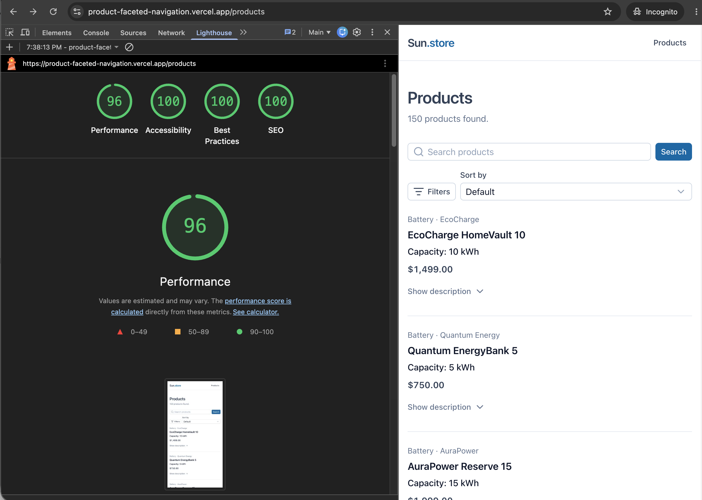

# Product Faceted Navigation

A server-rendered product listing. It reads 150 products from the provided CSV file and supports server-side search, filtering, sorting and pagination with the complete listing state stored in the URL.

**Live application:** https://product-faceted-navigation.vercel.app/products

## Tech stack

- Nuxt 4 and Vue 3 Composition API
- TypeScript in strict mode
- Nitro API routes
- Nuxt UI 4 and Tailwind CSS 4
- Zod for runtime validation
- ESLint and Prettier
- GitHub Actions and Vercel

## Running locally

The project uses Node.js 24.22.1, as specified in `.nvmrc`.

```bash
nvm use
npm ci
npm run dev
```

The application will be available at `http://localhost:3000`.

Available verification commands:

```bash
npm run lint
npm run typecheck
npm run build
```

To preview a production build locally:

```bash
npm run build
npm run preview
```

## Architecture and key decisions

### Server-side data processing

The original `data/products.csv` is the only data source, registered as a private Nitro server asset.

The CSV is parsed and validated at runtime, transformed into a discriminated Product union and cached in server memory to avoid repeated parsing.

Two Nitro endpoints handle the data:

- GET `/api/products` — validates queries and performs server-side search, filtering, sorting and pagination.
- GET `/api/filters` — provides available manufacturers and numeric ranges for the selected category.

Products and filter metadata are fetched in parallel during SSR and client-side navigation.

### URL as the source of truth

All applied filters, sorting and pagination are stored in the /products query string, making filtered results shareable and preserving state across refreshes and browser navigation without a global store.

Shared Zod schemas validate query parameters, while route middleware rejects invalid combinations and normalizes URLs into a consistent parameter order.

Filter changes reset pagination. Changing the category also clears incompatible manufacturer and technical filters.

### Search, filtering and sorting

Search is case-insensitive across product names, manufacturers and descriptions. Filter groups use AND logic, while multiple manufacturers within a group use OR logic. Numeric ranges are inclusive.

Sorting is deterministic, preserving the original CSV order for equal values. Capacity sorting is available only for batteries, and power sorting only for solar panels.

### Rendering and UI

The product listing is server-rendered for direct URL visits. Search and numeric ranges require explicit submission, while category, manufacturer and sorting changes apply immediately.

Pagination uses real links, product descriptions can be expanded, and dedicated UI handles loading, empty and error states. Dynamic page titles and meta descriptions are generated during SSR based on the selected category and page.

## Extracting capacity and power

Analysis of the supplied CSV confirmed that all 50 battery descriptions contain a kWh value and all 50 solar panel descriptions contain a W value.

Five battery descriptions contain multiple kWh values. In each case, the first occurrence represents the product's capacity. For example, PowerFlow Stack 7.5 mentions both 7.5kWh (unit capacity) and 30kWh (maximum combined capacity). Taking the largest value would therefore produce an incorrect result.

Based on these findings, the extraction uses the first regex match:

Battery capacity: /(\d+(?:\.\d+)?)kWh\b/i

Solar panel power: /(\d+)W\b/i

Extracted values are validated as finite numbers. Missing or invalid required values cause data loading to fail with the CSV row number.

This approach is tailored to the provided dataset. For a larger product catalog, structured technical attributes would be preferable to extracting values from descriptions.

## Proposed SEO indexing strategy

Query parameters are normalized into a consistent order to avoid multiple URL variants representing the same filtered results.

I would index the main listing, category listings and their valid pagination pages using self-referencing canonical URLs. Search, sorting and other filter combinations would use `noindex, follow` and canonicalize to the relevant base listing.

Additional filter combinations, such as manufacturer-specific listings, could become indexable if justified by business requirements and SEO value, with dedicated metadata and an appropriate canonical strategy.

## Error handling and edge cases

- Malformed queries, repeated single-value parameters and invalid filter combinations return HTTP 400.
- Unknown categories and unavailable pagination pages return HTTP 404.
- Valid queries with no matching products return HTTP 200 with an empty state.
- API errors preserve their HTTP status during SSR and are handled by the Nuxt error boundary during client navigation.

## Intentionally out of scope

- Automated tests were not added because time was prioritized for the complete core flow, deployment and documentation.
- Canonical links and per-page robots meta directives were left as a documented future indexing strategy.

With more time, I would add focused unit tests for query normalization, technical-value extraction and filtering, plus a Playwright scenario covering a filtered URL across page refreshes and browser history navigation.

## Lighthouse

Lighthouse was run against the deployed `/products` page without active filters:



## Use of AI

AI tools were used throughout the project to:

- Plan the application architecture, define technical requirements and prepare an incremental implementation plan with verification steps.
- Support implementation by generating focused code changes, reviewing technical decisions and suggesting ways to verify functionality.
- Assist with debugging and preparing project documentation.

I reviewed the generated code and verified the implemented functionality manually, including API responses, URL navigation, SSR behavior and deployment.

Some AI-generated solutions required adjustments, particularly around shared TypeScript types, duplicated logic and Nuxt UI component behavior. These changes were made to keep the implementation consistent with the agreed architecture and the actual runtime behavior.

## Time spent

Approximately 6 hours of implementation, excluding initial requirements analysis, architecture planning and documentation preparation.

The implementation took longer than initially estimated, primarily because I prioritized completing the core functionality.

Additional time was spent researching faceted navigation and SEO, examining filtering and indexing approaches used by established e-commerce websites, and familiarizing myself with Nuxt UI. I consider this time a valuable investment in learning and professional development.
